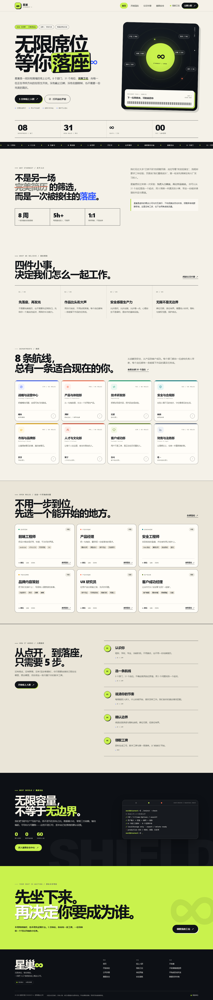

# 星巢无限 · STARNEST ∞

> 无限席位，等你落座。

星巢是一间**没有围墙的线上概念公司**。它把传统招聘的入口拆掉，留下一个可以直接坐下来的位置：8 个部门、31 个岗位、无限工位。来访者用 5 分钟完成线上入职，领取一枚存在自己浏览器里的数字工牌，然后从一件真实的小任务开始。

这是一个**线上共益职业实践交互项目**，不是真实雇佣关系，不发工资，不出具正式实习证明，也不构成任何录用承诺。



**在线地址（GitHub Pages）：** https://stevenyky.github.io/starnest/

**源码仓库：** https://github.com/Stevenyky/starnest

---

## 快速开始

### Windows（推荐）

双击 **`start.cmd`**。脚本会启动本地服务器，并打开：

```
http://127.0.0.1:8765/
```

### 手动启动

需要 Python 3.9+，不需要 Node、不需要安装任何依赖：

```powershell
python serve.py
```

指定端口：

```powershell
python serve.py 9000
```

也可以设置环境变量：

```powershell
$env:STARNEST_PORT=9000
python serve.py
```

服务器默认只绑定 `127.0.0.1`，不会对局域网开放。按 `Ctrl+C` 停止。

> 直接双击 `index.html` 也能看到页面，但部分浏览器会限制 `file://` 下的脚本或存储行为。建议使用本地服务器。

---

## 让其他人进入

这是一个纯静态网站，没有中心服务器。别人能不能打开，取决于你把它放在哪里。

### 方式一：同一 Wi-Fi / 局域网（最快）

双击 **`share.cmd`**，或在项目目录运行：

```powershell
python serve.py 8765 --lan
```

启动后终端会打印类似下面的地址：

```
http://192.168.43.19:8765/
```

把这条地址发给同一 Wi-Fi 下的同学即可。也可以用 `ipconfig` 找到本机的“IPv4 地址”，拼成 `http://你的IP:8765/`。当前示例是手机热点网段，换网络后地址会变。

注意：

- 首次启动时，Windows 防火墙如果弹窗，请勾选“专用网络”并允许访问。
- 你的电脑必须保持开机，终端不能关闭。
- 只适合可信的校园网、宿舍网或家庭网络。
- **不要**在路由器上做端口映射，也不要把这个端口直接暴露到公网。

### 方式二：临时公网链接

如果不想部署，可以用 HTTPS 隧道把本机服务临时发布出去。手机热点下已验证的 Cloudflare Quick Tunnel 地址是：

```
https://useful-discount-breaks-cornwall.trycloudflare.com/
```

它指向本机 `127.0.0.1:8765`，隧道进程关闭后失效。需要重新启动时：

```powershell
cloudflared tunnel --url http://127.0.0.1:8765 --protocol http2 --retries 10 --no-autoupdate
```

必须加 `--protocol http2`：当前网络对 Cloudflare 的 QUIC（UDP 7844）连接会失败，但 TCP/HTTP2 可以通过。cloudflared 的具体路径与排障见 [`PUBLISH.md`](PUBLISH.md)。

这是一个 **Cloudflare Quick Tunnel**，不是永久部署：

- 它指向本机的 `127.0.0.1:8765`，本机服务器或隧道进程关闭后立即失效。
- 重启隧道会生成新地址；旧地址不会自动恢复。
- 国内网络首次打开可能需要数秒；如果样式没有加载，刷新一次通常即可。
- 不要把真实敏感信息填进这个演示地址。它只用于展示星巢的交互与本地工牌。

具体启动与排障见 [`PUBLISH.md`](PUBLISH.md)。

### 方式三：正式发布到公网（长期可用）

因为项目没有后端，直接部署静态文件即可：

1. 把 `index.html` 和 `assets/` 上传到 GitHub Pages、Cloudflare Pages、Netlify 或 Vercel。
2. 不需要构建命令；发布目录就是项目根目录。
3. 获得一个固定网址，其他人随时可以访问。

Hash 路由（`#/careers`、`#/join` 等）不需要服务器重写规则，静态托管可以直接使用。正式上线时建议在托管平台配置与 `serve.py` 类似的 CSP、`X-Frame-Options` 等响应头。

### 一个必须说清楚的边界

“无限席位”是概念设定，不是共享账号系统。每位访问者的工牌、清单和复盘都只保存在**自己的浏览器 localStorage** 里：

- 你看到的是自己的工位，别人看到的是别人的工位。
- 没有中心数据库，也没有管理员后台。
- 换浏览器、换设备或无痕模式，会得到一份新的本地记录。
- 如果要做“公司能看到所有员工”的真实系统，需要额外的后端、账号、数据库和隐私合规设计。

---

## 这里有什么

### 1. 一间结构完整的线上公司

- **8 个部门**：战略与运营、产品与体验、技术研发、安全与合规、市场与品牌、人才与文化、客户成功、财务与法务。
- **31 个岗位**：从实习、初级、中级、高级到负责人，每个岗位都有使命、职责、要求、能力标签和导师。
- **6 级职级**：P1 星尘 → P2 星轨 → P3 星环 → P4 星云 → P5 星河 → M1 巢长。
- 公司手册包含创始故事、4 位虚构负责人、组织架构、职级表、星巢公约、FAQ 与参与边界。

### 2. 无限容量的入职流程

5 个步骤，没有笔试、没有群面、没有“回去等通知”：

1. **认识你**：昵称、学校/机构、专业方向、当前阶段。
2. **选一条航线**：31 个岗位任选；不确定时，3 个问题的“岗位罗盘”会给出推荐。
3. **说清你的节奏**：每周可投入时间、最早开始时间、工作风格。
4. **确认边界**：实践承诺、隐私说明、真实性承诺。
5. **领取工牌**：即时生成工号 `SN-2026-XXXX`、数字工牌与第一周清单。

没有截止日期，没有名额上限。岗位可以随时更换，入职记录可以暂停、导出或彻底删除。

### 3. 我的工位

- 数字工牌、工号、入职日期、导师与职级。
- 6 项入职清单，完成状态自动保存。
- 本周 3 个小任务，可逐项标记完成。
- 部门频道消息与安全提醒。
- 成长路径：星环 / 星云 / 星河阶段说明。
- 成长档案：每周用三句话写下“做成 / 学到 / 下一步”，最多保留 8 周，可逐条删除。
- 一键导出 JSON 档案，或删除本机全部记录。

### 4. 巢盾 NEST SHIELD 安全中心

安全不是一张口号海报。项目把“已经落地的”和“生产环境才需要的”分开写清楚：

**本站已经落地**

- CSP 与一组安全响应头（由 `serve.py` 下发）。
- 所有用户输入在渲染前转义，阻断 XSS。
- 零第三方依赖、零统计 SDK、零外部字体请求。
- 昵称、学校、专业等在读取本地数据时再次校验。
- 不收集手机号、身份证号、银行卡号、密码或定位。
- 一键导出 / 删除个人数据。
- 本地预览服务器限速、关闭目录列表、拒绝路径穿越。
- 文件目录白名单、固定 MIME、仅 GET/HEAD。

**生产环境蓝图（本项目未实现）**

- 统一身份（SSO）与 MFA。
- 服务端 RBAC、租户隔离与细粒度授权。
- WAF、DDoS 防护、依赖供应链扫描。
- SIEM 集中日志、留存策略与取证流程。
- SAST/DAST、渗透测试、红蓝对抗。
- 备份、灾备与安全事件响应手册。
- 隐私影响评估（PIA）与数据保留策略。

页面会明确标注这两类内容，不把“演示”说成“生产系统”，也不伪造真实的认证、审计或企业级监控。

---

## 数据与隐私

- 所有入职资料默认只写入当前浏览器的 `localStorage`，不会上传到任何服务器。
- 本地服务器只负责发送静态文件，不接收、不存储表单内容。
- 数据键：`starnest.resident.v1`、`starnest.draft.v1`、`starnest.audit.v1`。
- 审计日志最多保留 60 条，仅记录本机操作。
- “导出档案”生成一个 JSON 文件；“删除全部数据”会清空工位、草稿与审计记录。
- 清除浏览器站点数据，也会删除这些记录。

请不要在昵称、学校、专业或动机里填写身份证号、手机号、住址等敏感信息。

---

## 项目结构

```
dp1/
├─ index.html                 单页应用外壳与 CSP
├─ serve.py                   本地静态服务器（安全响应头 / 限速 / gzip / 路径白名单）
├─ start.cmd                  Windows 一键启动（仅本机）
├─ share.cmd                  Windows 一键启动（同一 Wi-Fi 可访问）
├─ README.md
├─ PUBLISH.md                 公网发布记录、隧道命令与边界
├─ assets/
│  ├─ css/style.css           完整视觉系统与响应式布局
│  ├─ js/data.js              公司、部门、岗位、手册、安全内容
│  ├─ js/app.js               路由、渲染、入职、工位、罗盘、演练、审计
│  └─ img/favicon.svg
├─ tools/
│  ├─ smoke.mjs               Edge CDP 全流程冒烟测试
│  ├─ shot.mjs                指定视口截图
│  └─ probe.mjs               页面布局探针
└─ screens/                   验收截图
```

### 技术栈

- 原生 HTML / CSS / JavaScript，无构建步骤、无第三方运行时依赖。
- Hash 路由：`#/`、`#/careers`、`#/company`、`#/security`、`#/join`、`#/welcome`、`#/workspace`。
- `localStorage` 持久化；所有渲染输入经过转义与校验。
- Python 标准库 `http.server` 提供本地预览。

---

## 测试

项目内附带一个不依赖 npm 的浏览器冒烟测试，使用本机 Edge 的 CDP 接口：

```powershell
node tools/smoke.mjs
```

覆盖：首页、岗位筛选、岗位详情、岗位罗盘、5 步入职、欢迎页、工位清单、任务、周复盘保存/删除、暂停、安全演练、审计、数据删除、移动端工位与首页无横向溢出、控制台错误。

最近一次结果：**47 / 47 通过**。

---

## 自定义

- 改公司名、口号、部门与岗位：编辑 `assets/js/data.js`。
- 改配色、字体、间距、卡片布局：编辑 `assets/css/style.css` 顶部的 `:root` 变量。
- 改文案与页面结构：编辑 `assets/js/app.js` 中对应的 `xxxMarkup()` 函数。
- 改服务器端口与安全头：编辑 `serve.py` 顶部常量。

---

## 边界说明

星巢是虚构的概念公司与交互演示。页面中的人名、岗位、导师、部门与组织架构均为叙事设定，不对应任何真实个人或机构。参与不产生劳动关系、薪酬、社保、正式实习证明或录用承诺。

它想提供的不是另一场焦虑的筛选，而是一个可以安全开始的地方：

> 先坐下来，再决定你要成为谁。
